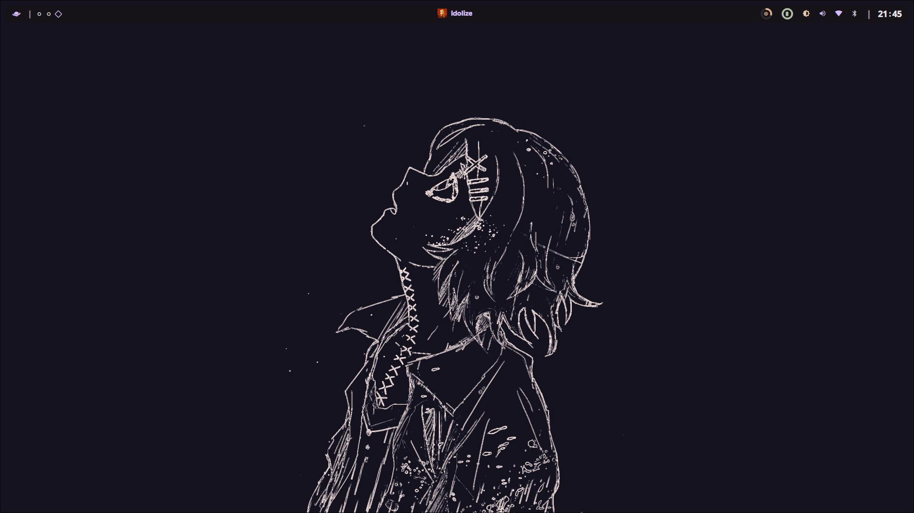

<div align="center">

# yunies

> 間違いも無駄も、全部愛していく。

Minimal, bloat-free Hyprland setup for **Arch Linux**, **Fedora**, and **Void Linux**.


</div>

---

## • overview •

<details>
  <summary>What this is / isn't</summary>
  <p align="center">
    <b>Is:</b> a set of Hyprland + Quickshell configuration files<br>
    <b>Is:</b> three distro-specific installers that set everything up for you<br>
    <b>Isn't:</b> a full system setup script (no GPU drivers, no zram, no bootloader)
  </p>
</details>

<details>
  <summary>Notable features</summary>
  <p align="center">
    <b>Minimal by design:</b> no bloat, no unused widgets<br>
    <b>Quickshell-based</b> bar and launcher and wallpaper selector<br>
    <b>Rofi</b> — kept because a few helper scripts depend on it &lt;3<br>
    <b>One-command install</b> per distro (AETHER / IGNITE / PHANTOM)<br>
    <b>Transparent installers:</b> every command is printed before it runs<br>
    <b>Material-ish theming:</b> wallpaper-driven color accents
  </p>
</details>

<details>
  <summary>Software overview</summary>

  | Software | Purpose |
  | ------------- | ------------- |
  | [Hyprland](https://github.com/hyprwm/hyprland) | The compositor (manages and renders windows) |
  | [Quickshell](https://quickshell.outfoxxed.me/) | QtQuick-based widget system (bar, launcher, wallpaper selector) |
  | [Rofi](https://github.com/davatorium/rofi) | App launcher and power menu — also used by some helper scripts |
  | Others | See the per-distro guides in [`installation/`](Installation/) for the full dependency list |

</details>

> [!WARNING]
> Requires **Hyprland ≥ 0.40** and a working Wayland session.

---

## • quick start •

</div>

```bash
git clone https://github.com.git
cd vroomies
chmod +x AETHER.sh IGNITE.sh PHANTOM.sh
```

<div align="center">

## • installation •

| Distro | Script | Package manager |
| :---: | :---: | :---: |
| **Arch Linux** | `./AETHER.sh` | paru / pacman |
| **Fedora** | `./IGNITE.sh` | dnf + COPR |
| **Void Linux** | `./PHANTOM.sh` | xbps + runit |

• **Prerequisites**: `git`, `curl`, and base development tools. •

### Keybinds

`Super` + `/` → keybind list | `Super` + `Enter` → terminal | `Super` + `Shift` + `Q` → close window

---

## • preview •



---

## • software & structure •

Includes **Hyprland** (compositor), **Quickshell** (widgets/bar/launcher), and corresponding configuration directories.

---

## • support & license •

Licensed under the [MIT License](LICENSE). Report bugs or star the project on [GitHub Issues](https://github.com/issues).

</div>
